# Codex Log Insight

**Collection log analytics.** Codex Log Insight reads your collection log and answers the questions the log itself never does: how lucky or dry you really are at your kill counts, how long each page has left, and which activities will give you a new slot the soonest.

Part of the **Codex** suite of RuneLite plugins, which share one look: warm ink, aged gold and the game's own fonts.

<p align="center">
  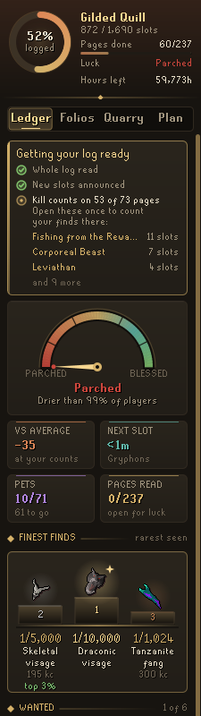
  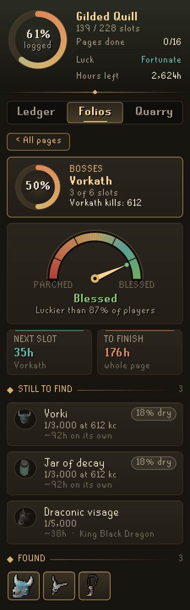
  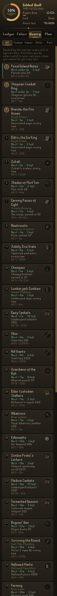
  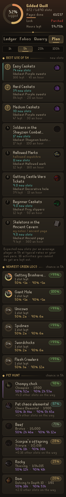
  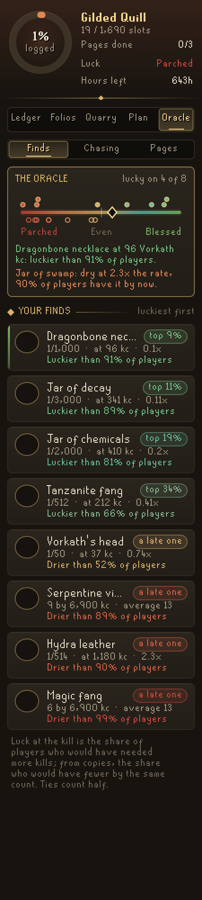
  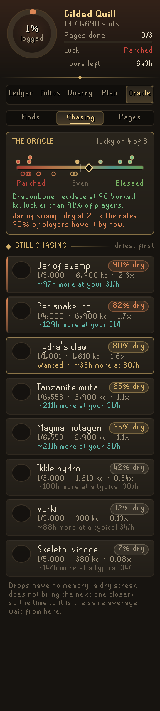
  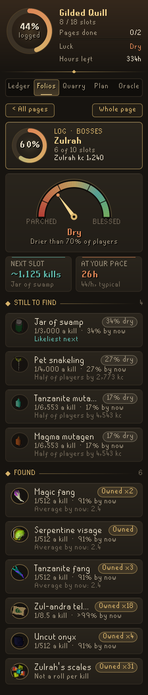
  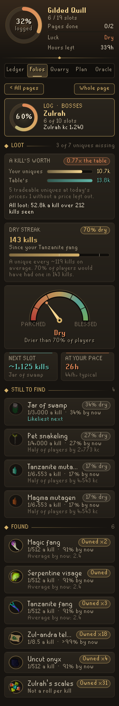
  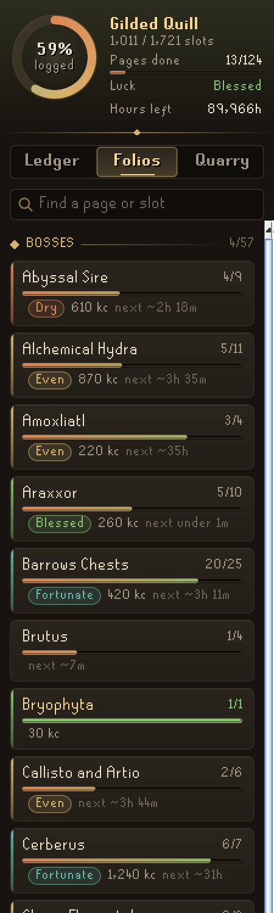
  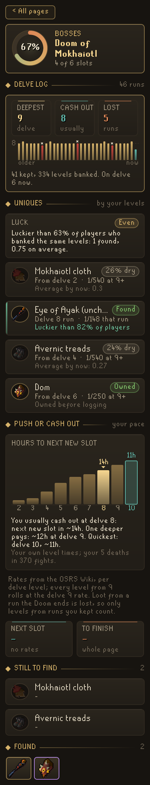
  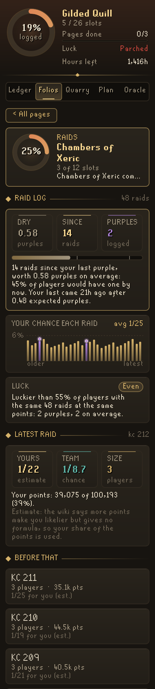
  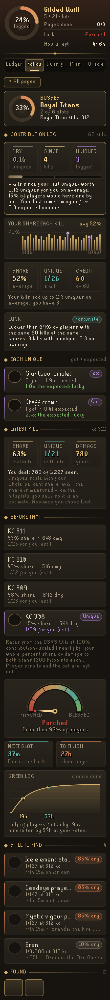
</p>

## What it does

- **Ledger.** Your whole log at a glance: slots owned, pages finished, a luck dial from Parched to Blessed comparing your slots with what an average player would own at your kill counts, and the hours left to finish the log. Tiles show how many slots you are ahead of or behind the average, your soonest next slot, your pets and how many pages' kill counts have been read. Below them, the best next hunts you can do right now, the drops you are driest on (at most two from one page), and your recent finds with the odds they came at and how lucky each one was.
- **Drops, not just slots.** The log counts every copy you have had, and Log Insight holds those counts against the odds at your kill counts: "950 drops, average 863", with its own verdict, for the whole log on the Ledger and for each page. It keeps saying how lucky a page has been after it is green, when owning the slots no longer can. Owned slots show their count like a stack in the game, and hover one for what an average player would have. Pets, stacks and slots the game deals out in sets are left out, as Collection Log Luck does, and so are drops commoner than 1 in 40, whose rough odds would swamp the rest. Nothing is said until the log or the page has been read.
- **Finest finds.** The Ledger puts your three rarest drops on a podium, the rarest in the middle: each on a gilt plinth with its odds, the kill count it came at and how far ahead of other players that was ("top 3%"). Fourth and fifth sit on slim rows beneath it. The shelf keeps its own five rarest, so a great drop stays however many ordinary ones follow it. Only drops Log Insight saw happen are on it. **Save finds card** (or Copy) under it makes a picture of the podium to share, with your name (turn off "Name on cards" to leave it off) and how full your log is; it waits for every item picture to load, so no plinth stands empty.
- **Folios.** Every log page with its progress, its luck verdict, your kill count and the time to the next slot. Open a page for its own dial, the time to finish it, every missing slot with its drop rate, how dry you are on it and where it comes quickest, and the slots you already own.
- **Quarry.** Every activity ranked by the wait for your next new slot, filtered by combat, minigames, other activities or pets (ranked by the wait for the pet itself). Activities you cannot do yet, by your real skill levels and finished quests, sink to the bottom and say what they need. Guaranteed rewards (a reward shop, a fixed number of completions) are counted exactly rather than as a random roll, rewards bought with points add up, and pieces that only drop in order are chained.
- **Plan.** Pick how long you have (1, 5, 20 or 100 hours) and Plan ranks what you can do right now by the new slots an average player would get from it in that time, with the chance of at least one, counting points rewards and pieces that drop in order properly. Below that, the pages nearest a green log with the hours by which half and nine in ten players finish them, and every missing pet as a hunt: where it comes quickest that you can do, the chance of seeing it in the time you picked, how long half and nine in ten players take, and how many other new slots usually turn up on the way.
- **Oracle.** Every rare slot you own or still chase, read at your own kill count. A slot Log Insight saw drop is read at the kill it came on: "Tanzanite fang at 212 Zulrah kc: luckier than 66% of players", with the odds and how many times the rate that was. A slot you own from before is read from the copies your log counts at the count they were read at ("6 by 6,900 kc, average 13"). A slot you still miss says how dry you are the way players say it: "Jar of swamp: dry at 2.3x the rate, 90% of players have it by now", and how long it should take from here at your own pace, or a typical one until yours is timed. A third list times every unfinished page: the average hours to finish it, the hours by which half and nine in ten players would, and whose pace that is. At the top, a luck scale from Parched to Blessed puts a bead for each find and a ring for each chase, with a diamond at the middle of your finds, under the oracle's two sentences: your luckiest find and your driest chase.
- **Log on any monster.** Right-click a boss or a Slayer monster and pick **Log**: the panel opens on just that monster's collection log slots, each marked owned or missing with its drop rate per kill and the share of players who would have it by your kill count, a luck dial for those slots, and the kills (and hours at your pace) an average player needs from here for the next slot it can still give you, naming the likeliest. Bosses are matched to the log's own kill counter (Zulrah to "Zulrah kills", Dusk and Dawn to the Grotesque Guardians); monsters the game keeps no count for use the rates Log Insight already times them by, and say so ("Rates on task"). Versions that drop differently are left out: only the Catacombs abyssal demons and dust devils roll the totem pieces, and the raid's lizardman shamans have no option. **Whole page** opens the full log page. The option sits just below Examine and never changes the left click; set "Log option on monsters" to Hold Shift or Off.
- **Loot beside the table.** The same monster view sets its drop table beside what you have actually had from it. **A kill's worth**: the table's uniques a kill at today's prices against your own (the copies your log counts of each, over the kill count they were read at), as "0.77x the table". Below that, what all its loot has been worth a kill since Log Insight began watching its kills ("All loot: 52.8k a kill over 212 kills seen"). **Dry streak**: kills since your last unique, counted from the last one seen in its loot, else the last new slot announced at its kill count, else your whole count if you own none, with how many players would have had one by then. A unique is a slot it rolls at 1 in 40 or rarer that is not a pet. Type a monster's name in the Folios search to open the same view without right-clicking it. Nothing is fetched from the internet: the tables are the bundled ones the oracle uses, and prices are RuneLite's own.
- **Delve log.** The Doom of Mokhaiotl's page keeps a log of every delve: how deep each run went, whether you kept the loot or the Doom took it, and a strip of your latest runs. Each unique (Mokhaiotl cloth, Eye of Ayak, Avernic treads, Dom) is read against the levels you actually banked, at the OSRS Wiki's rate for each delve level: how dry you are on the ones you miss, and for one Log Insight saw drop, the delve it came on, that run's odds and how lucky it was. Levels from runs that ended in death are left out, since their loot is lost. **Push or cash out** sets the hours to your next new slot against the depth you cash out at, with your own time per level and your own deaths, and says whether going one level deeper than you usually do pays. It is read in the panel between runs; nothing is drawn in the game view. Turn it off with "Delve log".
- **Raid log.** The Chambers of Xeric, Theatre of Blood and Tombs of Amascut pages each keep a log of every raid you finish: your points and the team's as the game gives them at the end, the raid level for the Tombs, the team size, and whether a purple came to you (from your reward chest or the log's new item line). Each raid's purple chance is worked from the OSRS Wiki's formula for that raid, and dryness is counted in **expected purples**, the sum of each raid's chance since your last purple, rather than kill count, so a run of low-point team raids weighs what it is worth. A strip shows your chance raid by raid with your purples marked, and your luck is read over the raids logged. Where the wiki gives no formula for your share of the team's chance (Chambers and Theatre teams), the figure is marked as an estimate. Nothing is read or drawn during a raid. Turn it off with "Raid log".
- **Contribution log.** The Nex, Corporeal Beast and Royal Titans pages each keep a log of your kills there, written only once a kill ends (nothing is shown while you fight): your share of the kill from the damage you dealt, the unique chance that share gave you by the OSRS Wiki's rule for that boss, and, for each unique, how many you would have on average from your kills against how many you got, with the share of players who would have one by now. Dryness is counted in **expected uniques** since your last, so a run of low-share kills weighs what it was worth. Averages over your kills (share, unique chance a kill, kills the game credited to you), a strip of your share kill by kill and your luck sit beside it. At the Corporeal Beast only the top damage dealer gets loot, so a kill with no kill count line gives you nothing. Shares measured in a team kill are marked as estimates, and Nex's split is an estimate in any team since the wiki gives no formula. Turn it off with "Contribution log".
- **Green log curve.** Every unfinished page shows the chance it is done against hours played, marked where half and nine in ten players would have finished it.
- **New slot plaque.** When a new slot drops, a gilt plaque shows its drop rate, your kill count and how lucky it was. Pets get their own violet plaque. A matching line can go to the chat box too. It works whether the game announces new slots in chat, with its pop-up, or both.
- **This session.** The Ledger keeps a tally of the play since you logged in: the kill counts you added, the new slots they gave, how many an average player would have found with the same kills, and how lucky that makes tonight. Only slots that actually drop while you play count as found, so reading your log in mid-session never looks like a lucky night, and a stale saved count never looks like hundreds of kills.
- **Dry milestones.** When a kill takes you past the count by which 9 in 10 players would have a slot you are still missing, and again at 99 in 100, a line in the chat box says so, with the slot's odds. Hover any slot for the counts by which half and 9 in 10 players have it. This waits until your whole log has been read once, so a slot you already own is never called dry. The check waits a moment after each kill count, so the slot that kill just gave you is never the one called dry.
- **Wanted slots.** Click any missing slot on a page to put it on your wanted list (up to six). The Ledger shows each wanted slot with how dry you are on it, a bar marked where half and nine in ten players would have it, how many more kills until each mark ("Half by 2,080 · 1,686 to go"), and the play after which there is an even chance of it at your pace. When a wanted slot drops, the plaque says "Wanted, and found" and it leaves the list. Click it again on its page to take it off.
- **Grind card.** While you add kill counts to a page, a small card in the game view shows the page, your count and what this session added, the slots left, the wait for the page's next slot, and the slot most worth watching (a wanted one first, else the one you are driest on) with a dry bar. It steps aside five minutes after your last kill count; turn it off with "Grind card".
- **Skilling pets at your level.** Skilling pets get likelier as you level (the chance is 1 in base minus 25 times your level), so Log Insight uses your real level for Rocky, Heron, Beaver, Rock golem, Baby chinchompa, Giant squirrel, Tangleroot and Rift guardian. Plan says what 99 would make the odds, or for a 99, what 200M experience would (15 times likelier).
- **Your own pace.** Rates start at typical kills per hour for a main or an ironman (picked automatically). As you play, Log Insight times your kill counts, and activities you do often switch to your own pace.

<p align="center">
  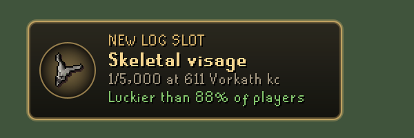
  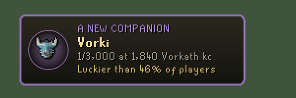
</p>

<p align="center">
  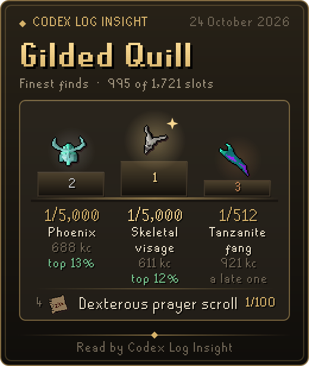
</p>

## Getting started

Open your collection log and press its **Search** button once. Log Insight reads every slot you own from it. Kill counts are read from the log pages you open, from the kill count messages in chat, and from the counts RuneLite's chat commands have already saved, so open the pages you care about once and the luck numbers fill in.

Until the whole log has been read, waits and rankings would describe an empty log, so the hours left, the next slot, Best next hunts, Longest waits, Quarry and Plan wait for that first read instead of guessing.

Until everything is in place, the Ledger opens with **Getting your log ready**: whether the whole log has been read (and read again when the game counts slots Log Insight has not seen, such as ones found on mobile), whether the game is set to announce new slots at all (with the notification off, a find goes unseen, and a chat line says so once a session), and how many pages have kill counts, naming the pages you have finds on but no count for, most finds first. Click one to open it. The card steps aside once all three are done.

## How the numbers work

- **Luck** is a percentile: the share of players with your kill counts who would own fewer of these slots than you, with ties split evenly. Above 85% is Blessed, above 65% Fortunate, 35% to 65% Even, below 35% Dry and below 15% Parched.
- **Dry** on a single slot is the way players say it: the share of players who would already have it by your kill count. "80% dry" means 80 in 100 would have it by now. A slot the game guarantees by a count you have passed (Vorkath's head by the 50th kill, say) reads **Overdue**.
- **Plans and green log curves** use the same odds as a distribution rather than an average: how many slots a stretch of play gives on average, and the hours by which half (50%) and nine in ten (90%) players would be done. Slots you would get from points or a fixed number of completions are counted from zero, so progress you already have towards them only makes things quicker.
- **Time to the next slot and to finish** race every missing slot of an activity against each other at its kills per hour, so a page with many rare slots is honest about how long the last one takes. Pieces that drop in order wait one after another, and rewards bought with points add up.
- **Skilling pets** use the OSRS Wiki's base chance for the action Log Adviser lists (seed stalls for Rocky, for example) at your real level. Until your levels are read they are shown at level 99.
- **Drops** add up every copy of the counted slots and compare the total with a Poisson count whose mean is what an average player would have had: the share of players with fewer, counting half of those with as many. Each slot's count is set against the kill counts it was read at, so kills since then do not make the log read drier; a slot that drops is counted as one until the next read. A slot is counted only when every source it drops from has a known kill count.
- **Luck at the kill** (Oracle) treats the kill a slot first comes on as a geometric wait at its chance per kill: the share of players who would have needed more kills, plus half of those who would have needed exactly as many. A slot the game guarantees by a count (Vorkath's head on the 50th kill) never waits past it. **From copies** is an exact binomial: the share of players with as many rolls who would have fewer copies, ties counted half; a slot that drops from several sources uses a Poisson count with the same mean. **Times the rate** is how many of the slot an average player would have had by your counts (6,900 kills at 1/3,000 is 2.3x). Drops have no memory, so the wait for a missing slot from here is the plain average at your pace however dry you are. The oracle reads rare slots only (1 in 40 or rarer, and pets), and calls nothing dry until your log has been read.
- **Delves** use the OSRS Wiki's unique table for the Doom of Mokhaiotl, one roll per cleared level from delve 2, with every level from 9 at the delve 9 rate; a test holds the sums against the wiki's own cumulative column. Dry on a unique is the share of players who would have it from the same banked levels; luck on a find is the share who would have needed more runs, plus half of those who needed exactly as many. A run is seen from the line the game sends at the end of each level (or the window that follows it), the loot claim and the Doom's own death animation; a run first seen part way down counts every level above it, since the delve level only climbs from 1. **Push or cash out** treats each run as levels fought one after another: each costs its time (your own once five levels are timed, else the wiki money making guide's 6 runs of delve 1 to 8 an hour, lobby included) and is survived at your own rate on that level, leaning on your overall rate where you have few fights. The wait for the next slot is the hours a run takes over the chance a run ends banked with a slot you are missing (any unique once you own all four). It counts runs since the delve log began, so a unique you owned before then is shown as owned and left out of the luck.
- **Raids** use the OSRS Wiki's chances. Chambers of Xeric: 1% per 8,676 team points, a roll capped at 65.7% (570,000 points) with further points rolling again, up to six; your share is taken as your share of the points (an estimate; the wiki says only that more points make you likelier). Theatre of Blood: 1/9.1 for the team without deaths, 1/7.7 in Hard Mode, the same at every team size, shared evenly (an estimate; deaths are not counted); Entry Mode has no stated chance and is not counted. Tombs of Amascut: 1% per 10,500 − 20 × RL points, RL being the raid level scaled by a third past 310 and a sixth past 430, capped at 55%, shared in proportion to points, so your chance is your own points' percent (in a team the total is not sent, so the cap is assumed unmet). Points are the game's own: the Chambers' team and personal scores as RuneLite's raids plugin reads them, and the Tombs' personal contribution, which the game sends only as the raid ends.
- **Contribution** is counted from hitsplats, as RuneLite's damage counter counts them: yours (`isMine`) and other players' (`isOthers`) on the NPCs whose damage makes up the kill. The whole is the wiki's hitpoints (Nex 3,400 plus her four generals at 500; the Corporeal Beast 2,000; Branda and Eldric 600 each) or all the damage seen when that is more (healing, reavers); with no other player's hit seen, the kill is yours alone. Nex: the uniques' effective rates a kill (an effective 1/43 for any) times your share, an estimate in a team, and a kill with no kill count line counts as no drop (the wiki says a minimum damage is needed without saying how much). Corporeal Beast: the whole table if the game gave you the kill, nothing if not. Royal Titans: the 100% rates (staff crown 1/75, giantsoul amulet 1/16) times your share cut to a whole percent, assuming you chose Loot; prayer scrolls (which stop dropping once read) and pets are left out.
- **Drop rates** follow Collection Log Luck's defaults for a typical player (raid points, team share, on-task Jad and Zuk). Where a rate changed during the game's life (a buff), the current rate is used. The rates the oracle shows for Zulrah, Vorkath and the Alchemical Hydra are checked against the OSRS Wiki's drop tables by a test (`WikiRatesTest`).

## Settings that matter

| Setting | Default | What it does |
| --- | --- | --- |
| Show plaque | On | The plaque in the game view when a new slot drops, with its odds and how lucky it was. |
| Plaque time | 8 s | How long that plaque stays up. |
| Luck in chat | On | A chatbox line saying how lucky each new slot was. |
| Grind card | On | The small card while you add kill counts to a page. |
| Delve log | On | Logs how deep each Doom of Mokhaiotl run went and whether you kept the loot, for its page's odds. |
| Raid log | On | Logs each raid you finish with its points, team and purple chance, for the raid pages' dryness in expected purples. |
| Contribution log | On | After each kill at Nex, the Corporeal Beast or the Royal Titans, logs your damage share, your unique chance and your odds so far on the boss's page. Never shown mid-fight. |
| Dry milestones in chat | On | A chatbox line when you pass the count by which 9 in 10, then 99 in 100, players would have a missing slot. |
| Kill rates | Match my account | Typical kills per hour for a normal account or an ironman. |
| Learn my pace | On | Uses your own kills per hour once Log Insight has timed enough of them. |
| Name on cards | On | Your character's name on the finest finds card. |
| Log option on monsters | Always | Adds Log below Examine on monsters with collection log slots. Hold Shift shows it only while Shift is held; Off hides it. |

## Privacy and rules

Log Insight only reads what the game already shows you: your collection log, its page counters, your chat messages and new slot pop-ups, your skill levels and your quest list, plus the kill counts RuneLite's own chat commands have saved. It does not click, send chat or touch the network. Its only menu change is its own Log option on monsters, placed below Examine; the game's options keep their order and the left click never changes. Your progress is saved per account in your RuneLite profile and never leaves your computer. If that save is ever damaged, or holds something only a newer Log Insight understands, Log Insight keeps every part it can read and keeps the saved text aside (as `progressUnreadable`) rather than writing over it. Some names belong to several slots (Mysterious page, Graceful hood, Rum): a new slot with such a name is marked only when the kill count that just rose says which one it was; otherwise none is marked, the Ledger asks for the log to be read again, and that read, once it holds every slot the game counts, replaces what was there, so a slot marked in error never stays. It needs no other Codex plugin.

## Credits

Drop rates and activity rates come from two open-source plugins, used under their BSD licenses: [Log Adviser](https://github.com/SFranciscoSouza/LogAdviser) and [Collection Log Luck](https://github.com/peanubnutter/collection-log-luck). See [THIRD_PARTY_NOTICES.md](THIRD_PARTY_NOTICES.md).

## Development

```bash
./gradlew build   # compile and run tests
./gradlew run     # launch RuneLite with the plugin loaded
python3 tools/build_data.py <log-adviser checkout> <collection-log-luck checkout>   # rebuild the rate data
```
