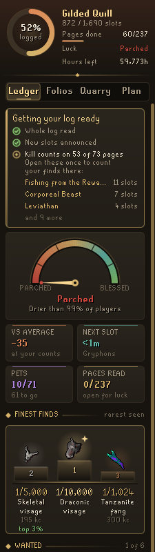
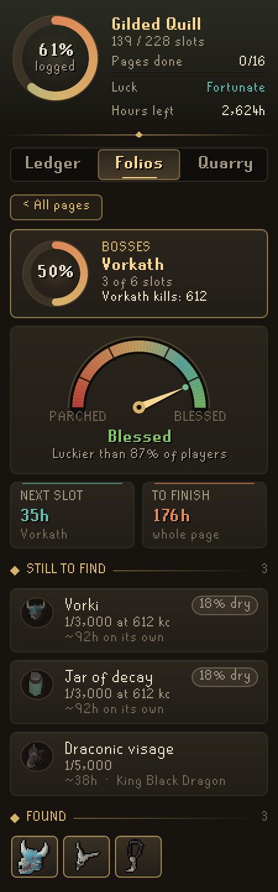
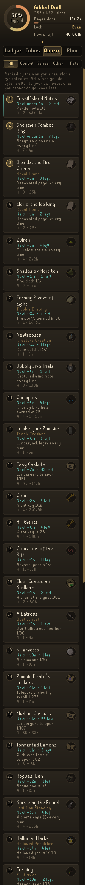
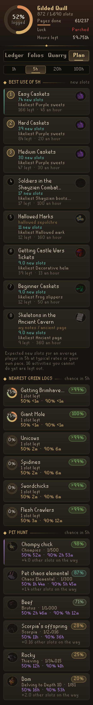
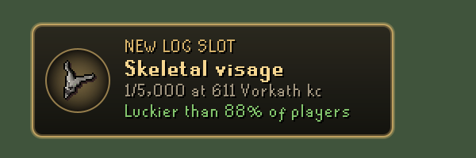
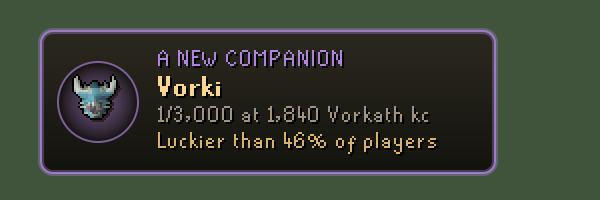

# Codex Log Insight

**Collection log analytics.** Codex Log Insight reads your collection log and answers the questions the log itself never does: how lucky or dry you really are at your kill counts, how long each page has left, and which activities will give you a new slot the soonest.

It is the third plugin in the **Codex** suite, after [Codex Navigator](https://github.com/Nubles/OSRS-Codex-Navigator) and [Codex Guardian](https://github.com/Nubles/OSRS-Codex-Guardian), and shares their look: warm ink, aged gold and the game's own fonts.

<p align="center">
  
  
  
  
</p>

## What it does

- **Ledger.** Your whole log at a glance: slots owned, pages finished, a luck dial from Parched to Blessed comparing your slots with what an average player would own at your kill counts, and the hours left to finish the log. Tiles show how many slots you are ahead of or behind the average, your soonest next slot, your pets and how many pages' kill counts have been read. Below them, the best next hunts you can do right now, the drops you are driest on (at most two from one page), and your recent finds with the odds they came at and how lucky each one was.
- **Folios.** Every log page with its progress, its luck verdict, your kill count and the time to the next slot. Open a page for its own dial, the time to finish it, every missing slot with its drop rate, how dry you are on it and where it comes quickest, and the slots you already own.
- **Quarry.** Every activity ranked by the wait for your next new slot, filtered by combat, minigames, other activities or pets (ranked by the wait for the pet itself). Activities you cannot do yet, by your real skill levels and finished quests, sink to the bottom and say what they need. Guaranteed rewards (a reward shop, a fixed number of completions) are counted exactly rather than as a random roll, rewards bought with points add up, and pieces that only drop in order are chained.
- **Plan.** Pick how long you have (1, 5, 20 or 100 hours) and Plan ranks what you can do right now by the new slots an average player would get from it in that time, with the chance of at least one, counting points rewards and pieces that drop in order properly. Below that, the pages nearest a green log with the hours by which half and nine in ten players finish them, and every missing pet as a hunt: where it comes quickest that you can do, the chance of seeing it in the time you picked, how long half and nine in ten players take, and how many other new slots usually turn up on the way.
- **Green log curve.** Every unfinished page shows the chance it is done against hours played, marked where half and nine in ten players would have finished it.
- **New slot plaque.** When a new slot drops, a gilt plaque shows its drop rate, your kill count and how lucky it was. Pets get their own violet plaque. A matching line can go to the chat box too. It works whether the game announces new slots in chat, with its pop-up, or both.
- **This session.** The Ledger keeps a tally of the play since you logged in: the kill counts you added, the new slots they gave, how many an average player would have found with the same kills, and how lucky that makes tonight. Only slots that actually drop while you play count as found, so reading your log in mid-session never looks like a lucky night, and a stale saved count never looks like hundreds of kills.
- **Dry milestones.** When a kill takes you past the count by which 9 in 10 players would have a slot you are still missing, and again at 99 in 100, a line in the chat box says so, with the slot's odds. Hover any slot for the counts by which half and 9 in 10 players have it. This waits until your whole log has been read once, so a slot you already own is never called dry. The check waits a moment after each kill count, so the slot that kill just gave you is never the one called dry.
- **Wanted slots.** Click any missing slot on a page to put it on your wanted list (up to six). The Ledger shows each wanted slot with how dry you are on it, a bar marked where half and nine in ten players would have it, how many more kills until each mark ("Half by 2,080 · 1,686 to go"), and the play after which there is an even chance of it at your pace. When a wanted slot drops, the plaque says "Wanted, and found" and it leaves the list. Click it again on its page to take it off.
- **Grind card.** While you add kill counts to a page, a small card in the game view shows the page, your count and what this session added, the slots left, the wait for the page's next slot, and the slot most worth watching (a wanted one first, else the one you are driest on) with a dry bar. It steps aside five minutes after your last kill count; turn it off with "Grind card".
- **Skilling pets at your level.** Skilling pets get likelier as you level (the chance is 1 in base minus 25 times your level), so Log Insight uses your real level for Rocky, Heron, Beaver, Rock golem, Baby chinchompa, Giant squirrel, Tangleroot and Rift guardian. Plan says what 99 would make the odds, or for a 99, what 200M experience would (15 times likelier).
- **Your own pace.** Rates start at typical kills per hour for a main or an ironman (picked automatically). As you play, Log Insight times your kill counts, and activities you do often switch to your own pace.

<p align="center">
  
  
</p>

## Getting started

Open your collection log and press its **Search** button once. Log Insight reads every slot you own from it. Kill counts are read from the log pages you open, from the kill count messages in chat, and from the counts RuneLite's chat commands have already saved, so open the pages you care about once and the luck numbers fill in.

## How the numbers work

- **Luck** is a percentile: the share of players with your kill counts who would own fewer of these slots than you, with ties split evenly. Above 85% is Blessed, above 65% Fortunate, 35% to 65% Even, below 35% Dry and below 15% Parched.
- **Dry** on a single slot is the way players say it: the share of players who would already have it by your kill count. "80% dry" means 80 in 100 would have it by now.
- **Plans and green log curves** use the same odds as a distribution rather than an average: how many slots a stretch of play gives on average, and the hours by which half (50%) and nine in ten (90%) players would be done. Slots you would get from points or a fixed number of completions are counted from zero, so progress you already have towards them only makes things quicker.
- **Time to the next slot and to finish** race every missing slot of an activity against each other at its kills per hour, so a page with many rare slots is honest about how long the last one takes. Pieces that drop in order wait one after another, and rewards bought with points add up.
- **Skilling pets** use the OSRS Wiki's base chance for the action Log Adviser lists (seed stalls for Rocky, for example) at your real level. Until your levels are read they are shown at level 99.
- **Drop rates** follow Collection Log Luck's defaults for a typical player (raid points, team share, on-task Jad and Zuk). Where a rate changed during the game's life (a buff), the current rate is used.

## Rules posture

Log Insight only reads what the game already shows you: your collection log, its page counters, your chat messages and new slot pop-ups, your skill levels and your quest list. It does not click, change menus, send chat or touch the network. Your progress is saved per account in your RuneLite profile and never leaves your computer.

## Credits

Drop rates and activity rates come from two open-source plugins, used under their BSD licenses: [Log Adviser](https://github.com/SFranciscoSouza/LogAdviser) and [Collection Log Luck](https://github.com/peanubnutter/collection-log-luck). See [THIRD_PARTY_NOTICES.md](THIRD_PARTY_NOTICES.md).

## Development

```bash
./gradlew build   # compile and run tests
./gradlew run     # launch RuneLite with the plugin loaded
python3 tools/build_data.py <log-adviser checkout> <collection-log-luck checkout>   # rebuild the rate data
```
